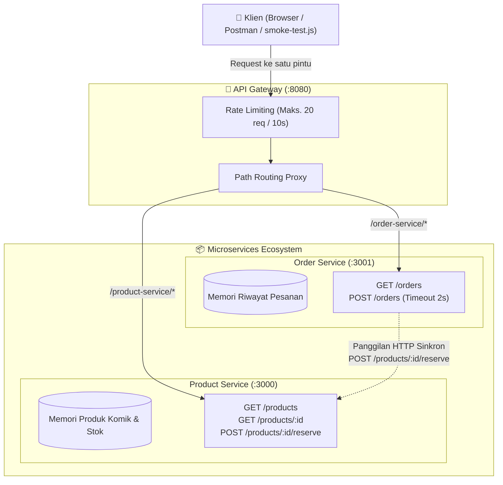

# Laporan Praktikum Lab 09: Memecah Aplikasi Menjadi Microservices
**Studi Kasus:** Sistem Toko Komik & Koleksi (Comic Store Microservices)

---

## 1. Diagram Arsitektur Hasil Pemecahan



---

## 2. Struktur Direktori Proyek Toko
```text
toko/
├── gateway/
│   ├── package.json
│   └── gateway.js             # API Gateway port 8080 (routing & rate limit)
├── product-service/
│   ├── package.json
│   └── product-service.js     # Service pengelola katalog dan stok komik (port 3000)
├── order-service/
│   ├── package.json
│   └── order-service.js       # Service pembuat & riwayat pesanan (port 3001)
├── monolith/
│   ├── package.json
│   └── monolith.js            # Versi monolit awal sebelum dipecah
├── smoke-test.js              # Skrip pengujian end-to-end otomatis
├── start-toko.bat             # Launcher praktis 3 service
├── .gitignore
└── README.md
```

---

## 3. Penerapan ke Proyek Kelompok (Comic Library System)

Berikut pemetaan batas service untuk sistem proyek kelompok **Comic Library**:

| Nama Service | Data yang Dimiliki | API yang Ditawarkan | Tempat Service Lain Harus Memanggil |
| :--- | :--- | :--- | :--- |
| **Service A**<br>*(Comic Catalog Service)* | Tabel database PostgreSQL Neon: `komik`, `kategori`, `genre`, metadata buku/komik | `GET /komik`<br>`GET /komik/:id`<br>`GET /health`<br>Endpoint GraphQL & gRPC | **Service B** memanggil `GET /komik/:id` saat pengguna menambahkan ulasan (*review*), guna memvalidasi bahwa komik yang diulas benar-benar ada di katalog. |
| **Service B**<br>*(Review & Order Service)* | Data ulasan pengguna (`reviews`: id, komik_id, rating, komentar) dan transaksi peminjaman/pembelian | `GET /reviews`<br>`GET /reviews/:id`<br>`POST /reviews`<br>`POST /orders` | Dipanggil oleh frontend / Gateway ketika pengguna membuka halaman detail ulasan komik atau melakukan transaksi pemesanan. |

---

## 4. Refleksi Singkat (Lab 09)

1. **(a) Keuntungan `order-service` tetap bisa menampilkan pesanan saat `product-service` mati:**
   Keuntungannya adalah sistem memiliki ketersediaan (*availability*) dan isolasi kegagalan (*fault tolerance*) yang tinggi, sehingga pengguna tetap bisa melihat riwayat pesanan, status transaksi, dan bukti nota belanja mereka tanpa mengalami *downtime* total meskipun server katalog produk sedang dalam perbaikan.
2. **(b) Risiko jika stok dikurangi lewat `reserve` tetapi pembuatan pesanan gagal sesudahnya:**
   Dampaknya terjadi inkonsistensi data (*ghost reservation* atau kehilangan stok fiktif), di mana stok komik pada `product-service` sudah terlanjur berkurang padahal pesanannya tidak pernah tercatat di `order-service`. Untuk menanganinya di aplikasi produksi, dibutuhkan mekanisme kompensasi (*rollback/undo*) atau *two-phase commit* / arsitektur berbasis event (Saga Pattern).
3. **(c) Harga yang harus dibayar dibanding monolit:**
   Harga yang dibayar adalah peningkatan kompleksitas operasional dan arsitektur, seperti bertambahnya latensi jaringan (*network overhead*), keharusan menangani kegagalan parsial (*timeout*, *network partitions*), serta kesulitan menjaga konsistensi data antar-service tanpa transaksi database ACID lokal seperti pada monolit.

